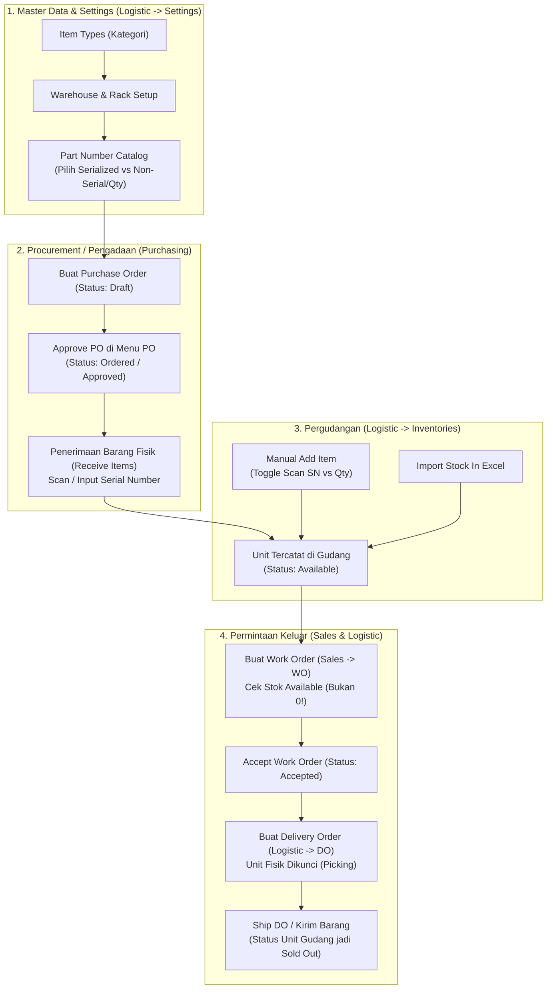

# Panduan Testing End-to-End WMS - PT Mitra Jaringan Global

Panduan ini dibuat untuk memandu tim tester memverifikasi seluruh alur operasional Warehouse Management System (WMS), mulai dari master data, pengadaan barang (PO), penerimaan barang fisik ke gudang, mutasi, hingga pembuatan Work Order (WO) dan pengiriman Delivery Order (DO).

> **Akses Cepat Versi Visual (HTML)**:
> Anda dan tim dapat langsung membuka file visual interaktif di browser melalui:
> **`public/panduan-testing.html`** atau via browser di **`http://<domain-atau-ip>/panduan-testing.html`**. File ini dilengkapi diagram alur, format laporan bug, dan tombol download template Excel.

---

## 1. File Template Excel untuk Uji Coba Import

Telah disiapkan 2 file Excel siap pakai di folder `public/test-templates/`:

1. **`public/test-templates/sample-import-part-number.xlsx`**
   - **Tujuan**: Menguji fitur import Part Number katalog (`Logistic -> Settings -> Part Number -> Import`).
   - **Isi**: 10 Part Number realistis mencakup tipe **Serialized** (Mikrotik Router, Switch, Ruijie AP, Ubiquiti, CCTV Hikvision) dan **Non-Serialized / Qty** (Kabel Belden 305m, Patch cord LC-LC, Konektor RJ45 Commscope, Baut Rack M6).
2. **`public/test-templates/sample-import-warehouse-stock-in.xlsx`**
   - **Tujuan**: Menguji fitur import barang fisik masuk gudang (`Logistic -> Inventories -> Import`).
   - **Isi**: 7 baris barang fisik siap suntik ke gudang *Stuff In* beserta lokasi rak.

---

## 2. Diagram Alur Sistem (End-to-End Workflow)



---

## 3. Konfirmasi Terkait Tombol Approve PO

> **Pertanyaan**: *Apakah fitur PO tetap di-approve di menu PO?*  
> **Jawaban**: **Ya, betul sekali!**
>
> 1. Form pembuatan PO menghasilkan status awal `Draft`.
> 2. Tombol **Approve** dan **Reject** berada tepat di dalam halaman detail PO tersebut (**`Purchasing -> Purchase Order -> Klik Nomor PO`**).
> 3. Tombol ini muncul untuk user yang memiliki permission `purchasing.approve` (misalnya Supervisor Purchasing atau Superadmin).
> 4. Setelah di-Approve, panel **Receive Items** langsung terbuka di halaman PO tersebut untuk mencatat penerimaan unit fisik ke gudang.

---

## 4. Daftar Skenario Uji Coba & Target Bug (Anomali yang Dicari)

### Skenario 1: Master Settings & Reorganisasi Sidebar
* **Lokasi**: Menu `Logistic -> Settings` (Submenu Part Number, Rack, Item Types).
* **Langkah**:
  1. Klik menu `Logistic` di sidebar. Periksa ada submenu collapsible bernama `Settings`.
  2. Klik submenu `Settings`, buka `Part Number`. Pastikan submenu tetap terbuka saat aktif.
  3. Klik tombol `Import` pada Part Number, pilih file `sample-import-part-number.xlsx`, lalu submit.
* **Target Pemeriksaan**:
  - [ ] 10 Part Number berhasil masuk tanpa error.
  - [ ] Muncul badge biru `Serialized (SN)` untuk item serial, dan badge kuning `Non-Serial (Qty)` untuk kabel/part consumable.
  - [ ] Tidak ada menu yang hilang di versi tampilan mobile (lebar layar HP).

---

### Skenario 2: Form Add Item (Toggle SN vs Qty & Validasi Serialized)
* **Lokasi**: Menu `Logistic -> Inventories -> Add Item`.
* **Langkah**:
  1. Buka form Add Item.
  2. Pilih Part Number bertipe *Serialized* (contoh: `RB5009UG+S+IN`). Perhatikan toggle input otomatis berada di **Serialized (Scan SN)**.
  3. **Uji Validasi**: Kosongkan kotak Serial Number, lalu klik `Save Item`.
  4. Periksa apakah sistem menolak dan menampilkan peringatan bahwa SN wajib diisi.
  5. Masukkan SN yang valid (contoh: `RB5009-TEST-001`), lalu simpan.
  6. Ulangi dengan memilih Part Number non-serial (contoh: `UTP-CAT6-BELDEN-305M`). Form harus otomatis berpindah ke **Non-Serialized (Quantity)**. Masukkan Qty dan simpan.
* **Target Pemeriksaan**:
  - [ ] Barang Serialized **wajib menolak penyimpanan** jika SN kosong.
  - [ ] Barang Non-Serialized tersimpan dengan jumlah kuantitas tanpa meminta SN.

---

### Skenario 3: Filter dan Kolom Dinamis di Detail Part Number (`items.part`)
* **Lokasi**: Menu `Logistic -> Inventories -> Klik salah satu Part Number`.
* **Langkah**:
  1. Klik baris Part Number bertipe serial (`CCR2216-1G-12XS-2XQ`).
  2. Uji filter: coba masukkan potongan SN, pilih filter Condition, pilih status, klik `Apply Filter`.
  3. Kembali ke Inventories, klik Part Number non-serial (`UTP-CAT6-BELDEN-305M`).
  4. Perhatikan header tabel: Kolom `SN / MAC ID` harus berganti menjadi `Qty / Satuan`.
  5. Coba ketik kata kunci di kolom search sidebar kiri ("Search SN, PN, item...").
* **Target Pemeriksaan**:
  - [ ] Semua filter berjalan cepat dan tombol `Reset` mengembalikan data utuh.
  - [ ] Header SN tidak muncul pada Part Number bertipe Qty.
  - [ ] Tidak ada error 404 / 500 saat mencari dari sidebar.

---

### Skenario 4: Work Order & Delivery Order (Pengecekan Bug Stok 0)
* **Lokasi**: Menu `Sales -> Work Order` & `Logistic -> Delivery Order`.
* **Langkah**:
  1. Buka `Work Order` -> Klik `Create Work Order`.
  2. Tambahkan baris item, pilih Part Number yang sudah memiliki stok di gudang.
  3. **Periksa Kuantitas**: Pastikan teks stok di samping Part Number menampilkan jumlah stok riil (contoh: `(2 Available)`), **BUKAN 0!**
  4. Simpan WO, lalu klik `Accept Work Order`.
  5. Buka menu `Logistic -> Delivery Order` (perhatikan posisinya sudah berada di bawah Logistic).
  6. Buat DO dari WO yang sudah di-accept.
  7. Lakukan picking / verifikasi unit, lalu klik `Ship Delivery Order`.
* **Target Pemeriksaan**:
  - [ ] Stok barang berstatus `Available` terbaca di WO (bug stok 0 tuntas).
  - [ ] Delivery Order berada di bawah grup menu Logistic.
  - [ ] Setelah DO dikirim, status barang di gudang otomatis menjadi `Sold Out` dengan tanggal `Stuff Out` terisi.

---

### Skenario 5: Tampilan Dark Mode (Select2 & Opsi Dropdown)
* **Lokasi**: Topbar -> Klik ikon Bulan/Matahari (Toggle Dark Mode).
* **Langkah**:
  1. Aktifkan dark mode.
  2. Buka `Inventories -> Add Item` atau `Work Order -> Create`.
  3. Buka dropdown Part Number (Select2) dan ketik kata kunci pencarian.
* **Target Pemeriksaan**:
  - [ ] Latar belakang kotak dropdown dan list berwarna gelap (`#1E293B`).
  - [ ] Teks opsi berwarna putih terang (`#F8FAFC`).
  - [ ] Saat item disorot (hover), background menjadi biru (`#0066A0`) dengan font putih (`#FFFFFF`).
  - [ ] Tidak ada lagi font putih di atas background putih yang membuat teks tidak terbaca.

---

## 5. Format Pencatatan Temuan Bug (Bagi Tester)

Minta tester mencatat anomali yang ditemukan menggunakan format sederhana ini:

```text
[TEMUAN BUG WMS]
- Halaman / URL:
- Aksi yang Dilakukan:
- Data Input / File:
- Hasil Error / Anomali:
- Tampilan (Light / Dark mode):
- Browser / Device:
```
