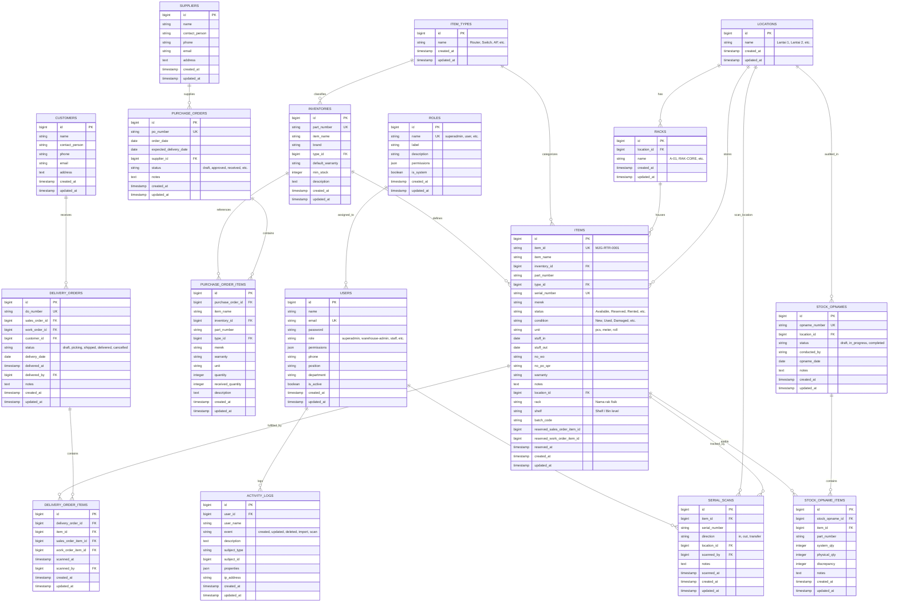

# 🗄️ Entity Relationship Diagram (ERD) & Struktur Database
**Project Magang: Warehouse & Logistics Management System (WMS)**

Dokumen ini memuat rancangan diagram relasi database (ERD), relasi antar-tabel, dan penjelasan struktur data yang digunakan pada aplikasi WMS ini.

---

## 1. Diagram ERD (Mermaid)

---

## 2. Struktur Detail Entitas Modul Warehouse (Core Inventory)

### A. Tabel `locations` (Warehouse / Storage Area)
Menyimpan daftar gudang utama atau lantai penyimpanan:
- `id` (PK, BigInt Auto Increment)
- `name` (VarChar 255): Nama gudang/lantai (contoh: *Warehouse 1 - Lantai 1*, *Warehouse 2 - Lantai 2*).
- `timestamps`

### B. Tabel `racks` (Storage Racks)
Menyimpan data rak penyimpanan yang berada di bawah lokasi gudang tertentu:
- `id` (PK, BigInt Auto Increment)
- `location_id` (FK $\to$ `locations.id`, Cascade On Delete)
- `name` (VarChar 255): Kode/nama rak (contoh: *RACK-A01*, *RACK-B02*).
- **Index**: Unique (`location_id`, `name`) — mencegah duplikasi rak dalam satu gudang.

### C. Tabel `items` (Physical Stock Units)
Menyimpan setiap unit fisik barang, baik barang serialised maupun quantity-based:
- `id` (PK, BigInt Auto Increment)
- `item_id` (VarChar 255, Unique): Nomor identifikasi unit sistem (contoh: `MJG-RTR-0042`).
- `item_name` (VarChar 255): Nama model/nama barang.
- `inventory_id` (FK $\to$ `inventories.id`, Nullable): Relasi ke master katalog part number.
- `part_number` (VarChar 255, Indexed): Part Number pabrikan barang.
- `type_id` (FK $\to$ `item_types.id`): Kategori perangkat (Router, Switch, Access Point, dll).
- `serial_number` (VarChar 255, Nullable, Indexed): Serial Number unik / MAC Address barang serialised.
- `merek` (VarChar 255, Nullable): Brand / Pabrikan (Mikrotik, Cisco, Ruijie, dll).
- `status` (VarChar 50): 7 Status standar magang (`Available`, `Reserved`, `In Transit`, `Rented`, `Under Service`, `Damaged`, `Lost`).
- `condition` (VarChar 50): Kondisi fisik barang (`New`, `Used`, `Normal`, `Damaged`).
- `unit` (VarChar 20): Satuan barang (`pcs`, `meter`, `roll`, `set`).
- `location_id` (FK $\to$ `locations.id`): Lokasi gudang penyimpanan saat ini.
- `rack` (VarChar 255, Nullable): Nama rak fisik tempat barang ditaruh.
- `shelf` (VarChar 255, Nullable): Tingkat rak / kompartemen / nomor bin (`SHELF-01`, `Bin A`, `Level 2`).
- `stuff_in` (Date, Nullable): Tanggal barang diterima ke gudang.
- `stuff_out` (Date, Nullable): Tanggal barang keluar dari gudang (saat pengiriman / sold / rental).
- `no_po_spr` (VarChar 255, Nullable): Nomor referensi PO / SPR penerimaan asal.
- `no_wo` (VarChar 255, Nullable): Nomor referensi Work Order saat pengeluaran.
- `warranty` (VarChar 50, Nullable): Durasi garansi dalam satuan bulan.
- `batch_code` (UUID, Nullable): UUID pengelompokan unit yang masuk dalam 1 batch transaksi penerimaan.
- `reserved_sales_order_item_id` / `reserved_work_order_item_id` (FK, Nullable): Penanda alokasi reservasi stok saat proses picking.
- `reserved_at` (Timestamp, Nullable): Waktu barang di-reserve.
- `notes` (Text, Nullable): Catatan riwayat spesifik unit.

### D. Tabel `inventories` (Master Part Number Catalog)
Menyimpan katalog master barang sebagai basis standarisasi Part Number:
- `id` (PK, BigInt Auto Increment)
- `part_number` (VarChar 255, Unique): Kode Part Number resmi produk.
- `item_name` (VarChar 255): Nama standar barang.
- `brand` (VarChar 255, Nullable): Pabrikan utama.
- `type_id` (FK $\to$ `item_types.id`): Tipe perangkat.
- `default_warranty` (VarChar 50, Nullable): Garansi bawaan default produk.
- `min_stock` (Integer, Nullable): Batas minimum stok sebelum trigger alert *Low Stock*.
- `description` (Text, Nullable): Spesifikasi dan keterangan umum.

---

## 3. Integritas Relasi & Aturan Bisnis Basis Data

1. **Anti-Duplikasi Serial Number**: Kolom `serial_number` divalidasi ketat di level request dan query sehingga satu nomor serial aktif tidak dapat didaftarkan dua kali.
2. **Hierarki Penyimpanan Terpadu**: Kombinasi `locations.name / items.rack / items.shelf` membentuk lokasi fisik terpadu:  
   $$\text{WH-01 / RACK-A01 / SHELF-02}$$
3. **Proteksi Integritas Relasi**:
   - Gudang (`locations`) tidak dapat dihapus jika masih menampung unit barang (`items_count > 0`) atau memiliki rak aktif.
   - Rak (`racks`) tidak dapat dihapus jika masih ditempati oleh unit barang aktif.
4. **Isolasi Stok Tersedia (Available)**:
   - Barang berstatus `Rented`, `Under Service`, `Damaged`, atau `Lost` dikeluarkan dari agregasi ketersediaan stok (`Available Qty`).
   - Unit yang sedang di-reserve (`reserved_at is not null`) dikunci agar tidak dapat diambil oleh pesanan lain secara bersamaan.

