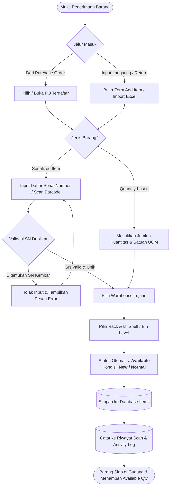
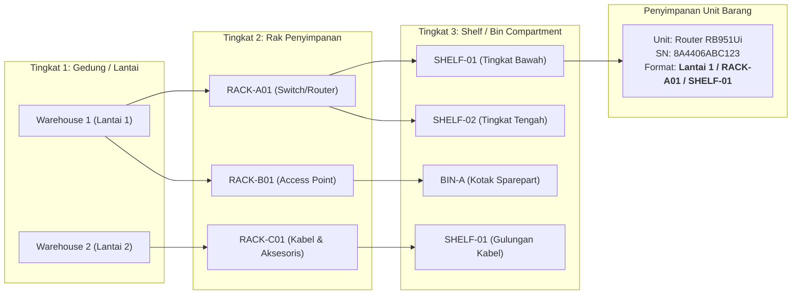
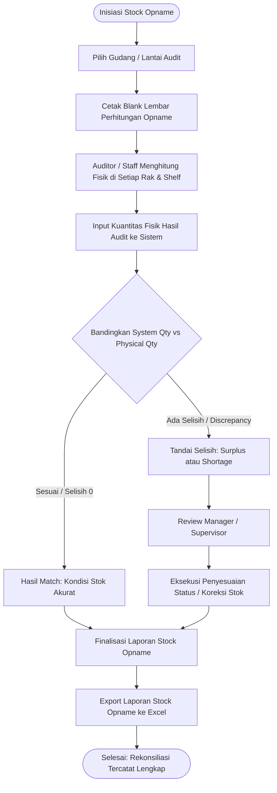

# 🔄 Flowchart Alur Kerja & Siklus Status Barang
**Project Magang: Warehouse & Logistics Management System (WMS)**

Dokumen ini menggambarkan alur kerja sistem gudang yang dibangun, mulai dari alur barang masuk (inbound), penataan lokasi rak/shelf, siklus 7 status barang, alur pengeluaran barang (outbound), hingga proses stok opname.

---

## 1. Flowchart Barang Masuk (Inbound / Penerimaan Barang)

Alur penerimaan barang dari vendor / supplier atau return perangkat ke dalam gudang:



---

## 2. Flowchart Hierarki Penyimpanan Fisik (Warehouse Hierarchy)

Sistem menerapkan hierarki 3 tingkat lokasi fisik untuk memastikan barang mudah dicari oleh staff lapangan:



---

## 3. Flowchart Siklus Hidup & Status Barang (7 Status Dokumen Magang)

Siklus transisi status unit barang dari awal masuk gudang hingga keluar / dioperasikan:

```mermaid
stateDiagram-v2
    [*] --> Available : Inbound Receipt / PO Receive / Import
    
    state "STOK TERSEDIA (Available Qty)" as Avail_Group {
        Available --> Reserved : Terpilih dalam Picking / Disiapkan untuk Order
        Reserved --> Available : Order Dibatalkan / Transaksi Batal
    }

    state "STOK TIDAK TERSEDIA (Non-Available)" as Non_Avail_Group {
        Reserved --> In_Transit : Barang Dikirim Antar-Gudang
        In_Transit --> Available : Tiba di Gudang Tujuan & Dikonfirmasi
        
        Reserved --> Rented : DO Selesai (Jenis: Rental Perangkat)
        Rented --> Under_Service : Unit Kembali dengan Gangguan
        Rented --> Available : Unit Kembali dalam Kondisi Normal
        
        Available --> Under_Service : Ditemukan Kerusakan Saat Audit / Maintenance
        Under_Service --> Available : Selesai Diperbaiki & Lolos Uji
        Under_Service --> Damaged : Unit Dinyatakan Rusak Total (Mati Total)
        
        Available --> Damaged : Rusak Fisik di Rak
        Available --> Lost : Hilang / Discrepancy Stock Opname
        
        Reserved --> Sold_Out : DO Selesai (Jenis: Sold / Terjual)
    }

    Damaged --> [*] : Disposal / Scrap
    Lost --> [*] : Write-Off
    Sold_Out --> [*] : Keluar Permanen ke Pelanggan
```

### Aturan Bisnis Perhitungan Stok:
- **Tersedia (Available)**: Hanya unit berstatus `Available` yang dihitung dalam *Available Qty*.
- **Terpakai / Keluar (Used)**: Unit yang berstatus `Sold Out`, `Lost`, `Rented`, keluar lewat DO (`stuff_out`), atau unit bekas pakai (`condition != New`) terhitung dalam metrik *Used*.
- **Non-Available**: Unit berstatus `Rented`, `Under Service`, `Damaged`, dan `Lost` **TIDAK PERNAH** dihitung sebagai stok tersedia.

---

## 4. Flowchart Barang Keluar (Outbound / Delivery Order)

Alur pengeluaran barang dari gudang berdasarkan Work Order (WO) atau permintaan penjualan:

```mermaid
flowchart TD
    Start_Out([Permintaan Pengeluaran / WO]) --> Check_Stock{Cek Stok Tersedia<br>Part Number di Gudang}
    
    Check_Stock -->|Stok Kurang| Reject_Order[Tolak Pembuatan DO / Buat Purchase Order Baru]
    Check_Stock -->|Stok Cukup| Create_DO[Buat Dokumen DO - Status: Draft]
    
    Create_DO --> Picking_Step[Proses Picking & Preparation]
    Picking_Step --> Reserve_Stock[Kunci Unit Barang: Status <b>Reserved</b><br><i>Stok tidak bisa diambil order lain</i>]
    
    Reserve_Stock --> Physical_Pick[Staff Mengambil Fisik dari Rak & Shelf]
    Physical_Pick --> Scan_Verify{Scan Verifikasi Serial Number}
    
    Scan_Verify -->|SN Tidak Cocok| Alert_Mismatch[Notifikasi: SN Tidak Sesuai Daftar Picking]
    Alert_Mismatch --> Physical_Pick
    
    Scan_Verify -->|SN Terverifikasi Cocok| Set_Ready[Status DO: <b>Ready to Ship</b>]
    
    Set_Ready --> Select_Type{Pilih Jenis Pengeluaran DO}
    
    Select_Type -->|1. Sold (Penjualan)| Dispatch_Sold[Status Unit: <b>Sold Out</b><br>Kuantitas Fisik Berkurang]
    Select_Type -->|2. Rental (Sewa)| Dispatch_Rent[Status Unit: <b>Rented</b><br>Tetap Aset Perusahaan]
    Select_Type -->|3. Service (Perbaikan)| Dispatch_Serv[Status Unit: <b>Under Service</b><br>Kirim ke Vendor/Teknisi]
    Select_Type -->|4. Return (Retur Vendor)| Dispatch_Ret[Kirim Balik ke Supplier]
    Select_Type -->|5. Damaged / Lost| Dispatch_Loss[Status Unit: <b>Damaged / Lost</b>]
    
    Dispatch_Sold --> Finalize_DO[Finalisasi DO - Status: <b>Delivered</b>]
    Dispatch_Rent --> Finalize_DO
    Dispatch_Serv --> Finalize_DO
    Dispatch_Ret --> Finalize_DO
    Dispatch_Loss --> Finalize_DO
    
    Finalize_DO --> Print_DO[Cetak Surat Jalan / Bukti Serah Terima DO]
    Print_DO --> End_Out([Selesai: Audit Trail & Riwayat Scan Tercatat])
```

---

## 5. Flowchart Stock Opname (Audit Fisik Gudang)

Proses verifikasi berkala antara saldo stok di sistem dan fisik di rak:



